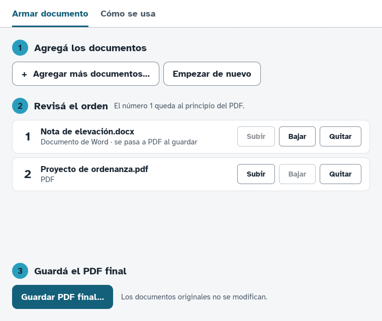

# Armador de PDF

Programa de escritorio para oficina que junta varios documentos (por ejemplo, una nota y un proyecto) en un solo PDF. Los documentos de Word se pasan a PDF automáticamente.

Funciona en Windows y Linux, sin instalación.

## Cómo se usa

1. **Agregá los documentos**: con el botón o arrastrándolos a la ventana. Acepta PDF, DOC, DOCX, ODT y RTF.
2. **Revisá el orden**: el número 1 queda al principio del PDF final. Se cambia con Subir y Bajar.
3. **Guardá el PDF final**: elegí carpeta y nombre.

Los documentos originales nunca se modifican. La pestaña «Cómo se usa» del programa trae el instructivo completo.



## Descarga

En la sección [Releases](../../releases/latest) hay dos paquetes, que ya traen LibreOffice incluido:

- **Windows**: `ArmadorPDF-Windows.zip`. Descomprimir y abrir `Armador de PDF.exe`.
- **Linux**: `ArmadorPDF-Linux.tar.gz`. Descomprimir y abrir `armador-pdf`.

No hay que instalar nada. El ejecutable tiene que quedar junto a la carpeta `libreoffice`.

## Estado

| Parte | Linux | Windows |
|---|---|---|
| Unir y ordenar PDF | Probado | Probado en Wine |
| Convertir Word a PDF con el LibreOffice incluido | Probado | **Falta probar en un Windows real** (LibreOffice no corre en Wine) |
| Interfaz | Probada | Probada en Wine |

Limitaciones conocidas: los PDF con contraseña se rechazan; los marcadores y los formularios rellenables de los PDF originales no pasan al archivo final; no se renumeran folios. Si una conversión tarda más de 3 minutos se cancela con un aviso.

## Cómo está hecho

- **Rust**, con [`egui`/`eframe`](https://github.com/emilk/egui) para la ventana, [`lopdf`](https://github.com/J-F-Liu/lopdf) para unir los PDF y [`rfd`](https://github.com/PolyMeilex/rfd) para los diálogos de archivos.
- **LibreOffice** en modo sin ventana para convertir Word a PDF. El programa lo busca primero junto al ejecutable (`libreoffice/` o `LibreOfficePortable/`) y después en el sistema.
- `src/nucleo.rs`: conversión y unión, sin interfaz. `src/main.rs`: la ventana.
- Tipografía [Atkinson Hyperlegible](https://www.brailleinstitute.org/freefont/) (licencia OFL, en `assets/`).

## Compilar

```bash
cargo build --release
```

Para generar el `.exe` de Windows desde Linux hace falta MinGW y el target de Rust:

```bash
rustup target add x86_64-pc-windows-gnu
cargo build --release --target x86_64-pc-windows-gnu
```

También se puede usar sin ventana:

```bash
armador-pdf --salida final.pdf nota.docx proyecto.pdf
```
