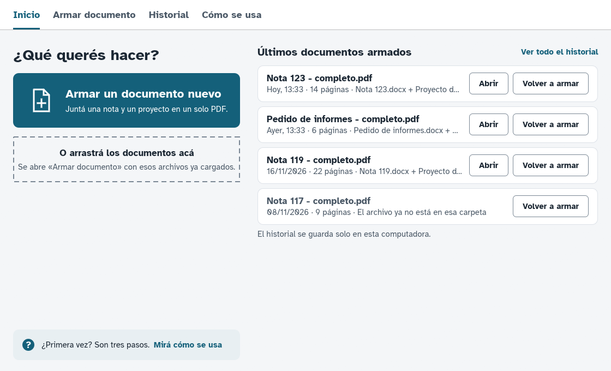
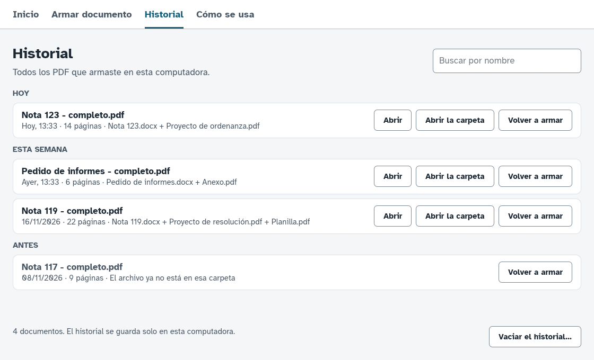
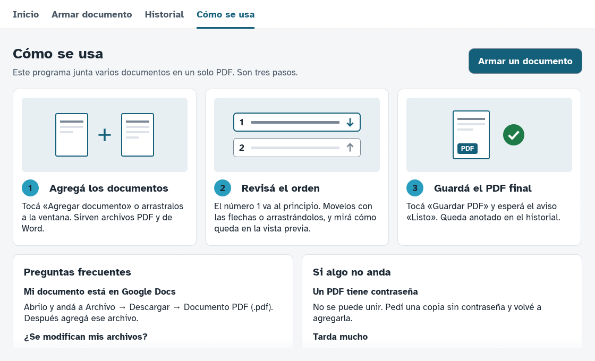
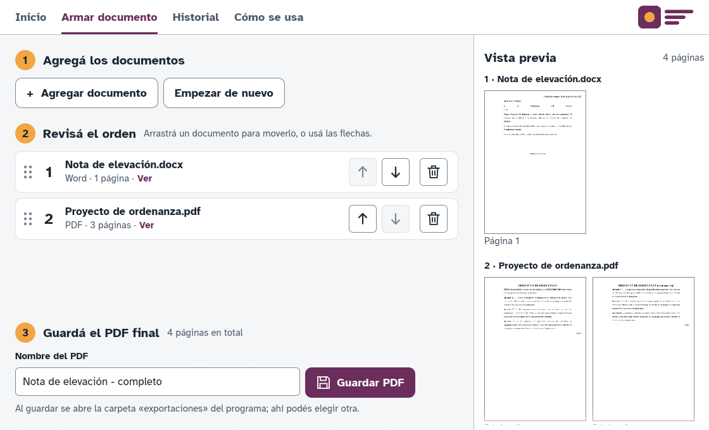

# Armador de PDF

[](https://github.com/pablo2h/armador-pdf/actions/workflows/pruebas.yml)

Programa de escritorio para oficina que **junta varios documentos en un solo PDF**: por ejemplo, una nota y el proyecto que la acompaña. Si algún documento está en Word, lo pasa a PDF solo.

Funciona en **Windows y Linux**, sin instalar nada. Desarrollado por **Horno de Barro**.


## Descargar

| Sistema | Archivo | Cómo abrirlo |
|---|---|---|
| **Windows** | [ArmadorPDF-Windows.zip](https://github.com/pablo2h/armador-pdf/releases/latest/download/ArmadorPDF-Windows.zip) (≈ 250 MB) | Descomprimir la carpeta y abrir `Armador de PDF.exe` |
| **Linux** | [ArmadorPDF-Linux.tar.xz](https://github.com/pablo2h/armador-pdf/releases/latest/download/ArmadorPDF-Linux.tar.xz) (≈ 170 MB) | Descomprimir la carpeta y abrir `armador-pdf` |

Los paquetes pesan porque traen LibreOffice adentro, que es lo que convierte los documentos de Word. Por eso **el programa tiene que quedar siempre dentro de su carpeta**, junto a la carpeta `libreoffice`.

> **Aviso de Windows.** El programa todavía no está firmado digitalmente, así que al abrirlo Windows puede mostrar «Windows protegió su PC». Tocá **Más información** y después **Ejecutar de todas formas**.

Todas las versiones están en [Releases](https://github.com/pablo2h/armador-pdf/releases), y los cambios de cada una en el [historial de cambios](CHANGELOG.md).

## Cómo se usa

Al abrirlo, la pantalla de **Inicio** tiene un botón grande para armar un documento nuevo y la lista de los últimos PDF armados.



### 1. Agregá los documentos

Tocá **Agregar documento** y elegí los archivos, o arrastralos desde una carpeta y soltalos sobre la ventana. Sirven archivos PDF y de Word (`.doc`, `.docx`).

### 2. Revisá el orden

Cada documento aparece con un número; el número 1 queda al principio del PDF final. Se reordenan con las **flechas** o arrastrándolos desde el asa de la izquierda. El **tacho** quita un documento de la lista (el archivo original no se borra, y durante unos segundos se puede deshacer). **Ver** lo abre para revisarlo.

A la derecha, la **vista previa** muestra las páginas del PDF final a medida que se arma, incluidas las de los documentos de Word.


### 3. Guardá el PDF final

Escribí el **nombre del PDF** (viene sugerido) y tocá **Guardar PDF**. Se abre la carpeta `exportaciones` del programa; ahí mismo podés elegir otra. Cuando aparece el aviso **Listo**, se puede abrir el PDF o su carpeta.


Si algo falla, el programa dice qué pasó y qué hacer:


### Historial

La pestaña **Historial** guarda todos los PDF armados en esa computadora, con fecha, páginas y documentos usados. **Volver a armar** carga los mismos documentos en el mismo orden: sirve cuando se corrige la nota y hay que rehacer el PDF.



### Si el documento está en Google Docs

Abrilo y andá a **Archivo → Descargar → Documento PDF (.pdf)**, y agregá ese archivo. Si necesitás seguir editándolo en Word, también podés descargarlo como `.docx`: el programa lo pasa a PDF solo.

### Para tener en cuenta

- Los documentos originales **nunca se modifican ni se borran**.
- Los PDF con contraseña no se pueden unir.
- La primera vez que se pasa un Word a PDF puede tardar hasta un minuto.
- El mismo instructivo está dentro del programa, en la pestaña **Cómo se usa**.



## Marca de la organización

El programa es genérico: el nombre, los colores y el logo de quien lo usa salen de un **paquete de marca**, una carpeta llamada `marca` junto al ejecutable.

```
marca/
  marca.txt
  logo.png
```

```text
nombre   = Organización de ejemplo
primario = #6B2D5C
acento   = #F2A541
logo     = logo.png
```

| Clave | Dónde se usa |
|---|---|
| `nombre` | Título de la ventana |
| `primario` | Botón principal, pestaña activa y zona para soltar. Tiene que ser oscuro: lleva texto blanco |
| `acento` | Círculo con el número de cada paso. El texto encima se elige solo (blanco u oscuro) |
| `logo` | PNG con fondo transparente, arriba a la derecha |

Para aplicar otra marca alcanza con cambiar esa carpeta; no hay que recompilar. Si la carpeta no existe, el programa usa el aspecto neutro de las capturas de arriba. En [`marcas/ejemplo`](marcas/ejemplo) hay un paquete de muestra; así se ve aplicado:



## Qué hace y qué no

| Hace | No hace |
|---|---|
| Une PDF en el orden que elijas | Intercalar páginas sueltas de un documento dentro de otro |
| Pasa Word (`.doc`, `.docx`), ODT y RTF a PDF | Renumerar folios ni agregar numeración |
| Funciona sin internet y sin instalación | Conservar marcadores ni formularios rellenables de los PDF originales |
| Muestra una vista previa del PDF final mientras se arma | |
| Lleva un historial y permite volver a armar un PDF anterior | Abrir PDF protegidos con contraseña |

## Estado de las pruebas

| | Linux | Windows |
|---|---|---|
| Unir y ordenar PDF | Probado | Probado |
| Pasar Word a PDF | Probado | Probado en las pruebas automáticas (ver abajo) |
| Paquete portable con su LibreOffice | Probado | **Falta la prueba manual en una PC con Windows** |

Si lo probás en Windows y algo no anda, por favor [abrí un aviso](https://github.com/pablo2h/armador-pdf/issues/new) contando qué hiciste y qué mensaje apareció.

## Para quien desarrolla

### Tecnología

- **[Rust](https://www.rust-lang.org/)**: un solo ejecutable por sistema, sin dependencias.
- **[egui / eframe](https://github.com/emilk/egui)**: la ventana.
- **[lopdf](https://github.com/J-F-Liu/lopdf)**: unión de los PDF.
- **[hayro](https://github.com/LaurenzV/hayro)**: dibujo de las páginas para la vista previa, en Rust puro.
- **[rfd](https://github.com/PolyMeilex/rfd)**: diálogos de abrir y guardar del sistema.
- **[LibreOffice](https://es.libreoffice.org/)** en modo sin ventana: pasa Word a PDF. El programa lo busca primero junto al ejecutable (`libreoffice/`) y después instalado en el sistema.
- Tipografía **[Atkinson Hyperlegible](https://www.brailleinstitute.org/freefont/)**, incluida en el ejecutable (licencia OFL, en `assets/`).

### Estructura

```
src/nucleo.rs    conversión, unión, historial y pruebas (sin interfaz)
src/main.rs      la ventana y el sistema de diseño
src/marca.rs     lectura del paquete de marca
src/vista.rs     vista previa de las páginas
marcas/          paquetes de marca listos para usar
assets/          tipografía
tests/datos/     documentos de Word para las pruebas
docs/            capturas de este README
```

### Compilar

```bash
cargo build --release
```

Para generar el `.exe` de Windows desde Linux hacen falta MinGW y el target de Rust:

```bash
rustup target add x86_64-pc-windows-gnu
```

```bash
cargo build --release --target x86_64-pc-windows-gnu
```

### Pruebas

```bash
cargo test --release
```

Son catorce pruebas: historial, nombre del archivo, lectura y contraste de la marca, formatos aceptados, orden de las páginas, tamaño de página heredado, documento repetido, errores, que los originales no se toquen y una prueba de punta a punta que pasa un `.docx` y un `.doc` a PDF con LibreOffice real y los une con otro PDF. Esa última se omite si LibreOffice no está instalado.

En cada cambio, GitHub las corre automáticamente **en Linux y en Windows**, con LibreOffice instalado en ambos: es la pestaña [Actions](https://github.com/pablo2h/armador-pdf/actions).

### Uso sin ventana

```bash
armador-pdf --salida final.pdf nota.docx proyecto.pdf
```

### Capturas

Las imágenes de este README las genera el propio programa:

```bash
ARMADOR_MARCA=marcas/ejemplo ARMADOR_DEMO=lista ARMADOR_CAPTURA=captura.ppm target/release/armador-pdf
```

`ARMADOR_DEMO` admite `inicio`, `historial`, `vacio`, `lista`, `listo`, `error`, `avance` y `ayuda`.

## Créditos y licencias

- Desarrollado por **Horno de Barro**. Código bajo [licencia MIT](LICENSE): se puede usar, modificar y redistribuir libremente.
- Los paquetes incluyen LibreOffice, de The Document Foundation, bajo licencia MPL 2.0; su licencia va dentro de la carpeta `libreoffice`.
- Atkinson Hyperlegible, del Braille Institute, bajo licencia SIL OFL 1.1.
